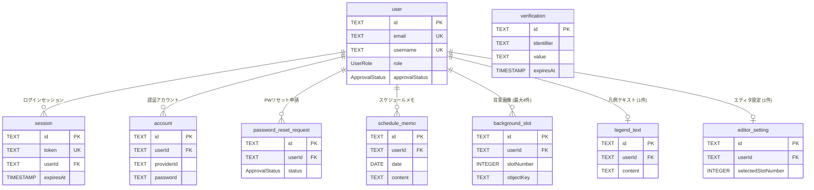

# テーブル定義書

[← 設計資料一覧](../README.md) ・ [型早見表](#型早見表-postgresql--prisma--typescript)

データベースは PostgreSQL (ローカル: Docker / 本番: Neon)、ORM は Prisma です。
定義の正は `prisma/schema.prisma` と `prisma/migrations/` です。テーブルを変更したら `npm run db:migrate` でマイグレーションを作成し、この資料も更新してください。

## テーブル一覧

| No | リンク | テーブルID (Prisma モデル名) | テーブル名(論理名) | テーブル名(物理名) | 区分 | 備考・説明 |
| --- | --- | --- | --- | --- | --- | --- |
| 1 | [GO](01-user.md) | User | ユーザー | `user` | 認証 (BetterAuth) | ログインID・メールアドレス・権限・承認ステータスを管理する |
| 2 | [GO](02-session.md) | Session | ログインセッション | `session` | 認証 (BetterAuth) | ログイン中のセッション (Cookie のトークン) を管理する |
| 3 | [GO](03-account.md) | Account | 認証アカウント | `account` | 認証 (BetterAuth) | パスワードハッシュを管理する |
| 4 | [GO](04-verification.md) | Verification | 検証トークン | `verification` | 認証 (BetterAuth) | パスワード再設定URLのトークンを管理する |
| 5 | [GO](05-password-reset-request.md) | PasswordResetRequest | パスワードリセット申請 | `password_reset_request` | 認証 (アプリ独自) | 管理者承認制のPWリセット申請を管理する |
| 6 | [GO](06-schedule-memo.md) | ScheduleMemo | スケジュールメモ | `schedule_memo` | アプリ | 日付ごとの空き枠メモ (1ユーザー × 1日 = 1件) |
| 7 | [GO](07-background-slot.md) | BackgroundSlot | 背景画像スロット | `background_slot` | アプリ | ストーリーズの背景画像 (1〜4番の固定スロット) |
| 8 | [GO](08-legend-text.md) | LegendText | 凡例テキスト | `legend_text` | アプリ | ストーリーズ下部の凡例カードの文章 (1ユーザー1件) |
| 9 | [GO](09-editor-setting.md) | EditorSetting | エディタ設定 | `editor_setting` | アプリ | エディタで選択中の背景スロット (1ユーザー1件) |

## 列挙型 (ENUM) 一覧

| 型名(物理名) | 論理名 | 値 | 値の意味 | 使用カラム |
| --- | --- | --- | --- | --- |
| `ApprovalStatus` | 承認ステータス | `PENDING` | 承認待ち | `user.approvalStatus`, `password_reset_request.status` |
| | | `APPROVED` | 承認済み | |
| | | `REJECTED` | 却下 | |
| `UserRole` | ユーザー権限 | `USER` | 一般ユーザー (サロン運用者) | `user.role` |
| | | `ADMIN` | 管理者 (新規登録・PWリセットの承認者) | |

## ER図

すべてのテーブルは `user` に紐づき、ユーザーを削除すると関連データもまとめて削除されます (`ON DELETE CASCADE`)。

`verification` はユーザーと外部キーで結ばれていません (`value` にユーザーIDを文字列で保持します)。

## 命名規則

| 対象 | 規則 | 例 |
| --- | --- | --- |
| テーブル名(物理名) | スネークケース (`@@map` で指定) | `schedule_memo` |
| テーブルID | Prisma のモデル名。パスカルケース | `ScheduleMemo` |
| カラム名(物理名) | キャメルケース (BetterAuth の規約に合わせ、Prisma のフィールド名と同じ) | `userId`, `createdAt` |
| 主キー | `id` (文字列)。BetterAuth のテーブルは BetterAuth が、アプリのテーブルは cuid で自動採番 | `cmh1x2y3z0000abcd` |
| 外部キー | `userId` → `user.id` | |
| 作成日時・更新日時 | 全テーブル共通で `createdAt` / `updatedAt` を持つ。`updatedAt` は更新時に Prisma が自動で更新 | |

SQL で直接参照する場合、キャメルケースのカラム名はダブルクォートで囲む必要があります (例: `SELECT "userId" FROM schedule_memo;`)。

## 型早見表 (PostgreSQL ⇔ Prisma ⇔ TypeScript)

| 分類 | PostgreSQL型 | Prisma型 | TypeScript型 (API) | 主な用途・覚え方 |
| --- | --- | --- | --- | --- |
| 文字列系 | `TEXT` | `String` | `string` | ID・メール・本文など文字列全般。長さの上限は DB では持たず、入力チェック (zod) で制限する |
| 数値系 | `INTEGER` | `Int` | `number` | スロット番号など小さな整数 (〜約21億) |
| 日付・時刻系 | `DATE` | `DateTime @db.Date` | `string` (`"YYYY-MM-DD"`) | 時刻を持たない日付 (メモの対象日)。UTC 0時として扱う |
| 日付・時刻系 | `TIMESTAMP(3)` | `DateTime` | `string` (ISO 日時) | 日時 (ミリ秒まで・タイムゾーンなし、UTC で保存) |
| 真偽値 | `BOOLEAN` | `Boolean` | `boolean` | true / false |
| 構造・その他 | `ENUM` | `enum` | 文字列のユニオン型 | 固定の候補値 (承認ステータス・権限) |

- NULL を許容するカラムは Prisma で `?` 付き (例: `String?`)。API のレスポンスでは、文字列の NULL は `""`、日時の NULL は `null` に変換して返す。
