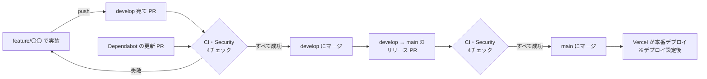
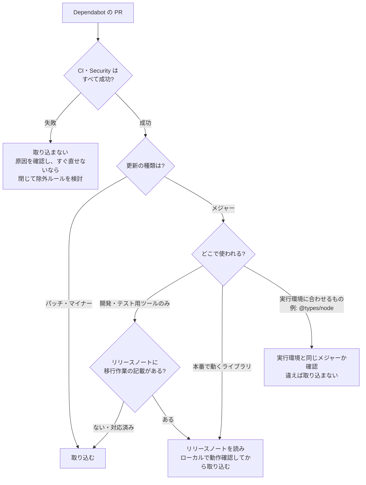

# CI・Dependabot 運用ガイド

[← 設計資料一覧](../README.md) ・ [CI / 自動化 (仕組みの説明)](ci.md)

[CI / 自動化](ci.md) が「何が自動で動いているか」の説明なのに対し、この資料は「**何が起きたら、何をするか**」の手順書です。

## 1. 変更が本番に届くまでの流れ

- 必須チェックは `quality` (CI)・`npm-audit`・`dependency-review`・`codeql` (Security) の4つ。すべて成功しないとマージボタンが押せない ([ブランチ保護ルール](ci.md#ブランチ保護ルール))。
- PR に追加でコミットを push すると、4チェックは自動でやり直される (古い実行はキャンセルされる)。
- Vercel を GitHub と連携すると、PR ごとに確認用のプレビューURLが発行され、main へのマージで本番に反映される。連携したら、この図と「8. デプロイとのつながり」を更新する。

## 2. 自分の PR で CI が失敗したとき

### 手順

1. PR 下部のチェック一覧で、✗ が付いたチェックの「Details」を開く
2. 赤くなっているステップを開き、ログの最後のほうにあるエラーを読む
3. 下の表のコマンドをローカルで実行して同じエラーを再現し、直してから push する

| 失敗したチェック・ステップ | ローカルで再現するコマンド | よくある原因と直し方 |
| --- | --- | --- |
| `quality` / ESLint | `npm run lint` | 未使用の変数・ルール違反。`npx eslint --fix <ファイル>` で直るものもある |
| `quality` / Prettier | `npm run format:check` | 整形漏れ。`npm run format` で自動整形 |
| `quality` / TypeScript | `npm run typecheck` | 型エラー |
| `quality` / Vitest | `npm run test:coverage` | テストの失敗、またはカバレッジ 90% 未満。utils・atoms・molecules を追加したらテストも追加する |
| `quality` / Build | `npm run build` | 本番ビルド時だけ起きるエラー (サーバー専用コードをクライアントで import した等) |
| `quality` / License check | `npm run license:check` | 許可リスト外のライセンスのライブラリを追加した。別のライブラリを探す |
| `npm-audit` | `npm audit --audit-level=high` | 依存ライブラリに High 以上の脆弱性。「6. 脆弱性が見つかったとき」を参照 |
| `dependency-review` | (ローカル不可) | PR で追加・更新したライブラリに High 以上の脆弱性。PR のコメントに対象が書かれる |
| `codeql` | (ローカル不可) | コードに High 以上の脆弱性の疑い。ログと Security タブ → Code scanning に場所と理由が出る |

- `codeql` は誤検知もあり得る。内容を読んで問題ないと判断できる場合は、Security タブの該当アラートで「Dismiss」(理由を選択) すると、次回以降は検出されない。
- どうしても原因が分からない一時的な失敗 (GitHub 側の障害など) は、Actions の実行ページ右上の「Re-run failed jobs」で再実行できる。

## 3. Dependabot の PR を取り込むか判断する

毎週月曜 9:00 に、develop 宛ての更新 PR が届く。**一律に取り込まず、1件ずつ次の順で判断する。**

### 判断の基準

| 更新の種類 | 例 | 判断 |
| --- | --- | --- |
| パッチ (`1.2.3` → `1.2.4`) | 不具合修正 | CI が成功すれば取り込む |
| マイナー (`1.2.3` → `1.3.0`) | 後方互換のある機能追加 | CI が成功すれば取り込む |
| メジャー (`1.x` → `2.x`) | 互換性のない変更を含み得る | CI が成功しても、リリースノートの「Breaking Changes」「Migration」を確認する |
| GitHub Actions の更新 | `actions/checkout` v4 → v7 | PR の CI 自体が新しいバージョンで動くため、成功していれば取り込んでよい |

- **リリースノートの場所**: Dependabot の PR 本文に「Release notes」「Changelog」「Commits」が折りたたみで載っている。
- **CI が成功しても安心できないケース**: CI はテストとビルドが通ることしか確認しない。画面の見た目や、テストの無い部分の挙動はローカルで `npm run dev` や `npm run test:e2e` で確認する。
- **本番で動くライブラリ**: `next`, `react`, `better-auth`, `@prisma/client`, `@aws-sdk/*`, `zod` など (`package.json` の `dependencies`)。
- **開発・テスト用ツール**: `eslint`, `prettier`, `vitest`, `jsdom`, `@playwright/test`, `storybook` など (`devDependencies`)。壊れても本番には影響しない。

## 4. 取り込む手順

1. PR の「Files changed」で、`package.json` と `package-lock.json` 以外が変わっていないことを確認する
2. 「Merge pull request」でマージする
3. **残りの Dependabot PR は `package-lock.json` が衝突した状態になるため、数分待つ**。Dependabot が自動で作り直し (リベース)、CI も再実行される
4. CI が緑に戻ったら次の PR をマージする

複数ある場合のおすすめの順番 (影響の小さいものから):

1. GitHub Actions の更新
2. パッチ・マイナー更新のまとめ PR
3. 開発・テスト用ツールのメジャー更新
4. 本番で動くライブラリのメジャー更新

マージ後、手元の develop を最新にしておく: `git switch develop && git pull`

## 5. Dependabot への指示 (PR へのコメント)

PR にコメントを書くと Dependabot が操作を行う。

| コメント | 動き |
| --- | --- |
| `@dependabot rebase` | 最新の develop に合わせて作り直す (衝突したまま放置されているとき) |
| `@dependabot recreate` | PR を一から作り直す (手で変更を加えてしまったときなど) |
| `@dependabot ignore this major version` | このメジャーバージョンを今後提案しない |
| `@dependabot ignore this minor version` | このマイナーバージョンを今後提案しない |
| `@dependabot ignore this dependency` | このライブラリの更新を今後一切提案しない (非推奨) |

コメントでの除外は設定ファイルに残らず、後から理由が分からなくなる。**恒久的に除外するものは `.github/dependabot.yml` の `ignore` に理由と解除条件を書いて PR で追加する** (次の表)。

### 除外ルール (`dependabot.yml` の `ignore`)

| ライブラリ | 除外する更新 | 理由 | 解除する条件・手順 |
| --- | --- | --- | --- |
| `typescript` | メジャー更新 (7.x 以降) | TypeScript 7 はネイティブ実装への全面刷新で、ESLint の TypeScript 対応 (typescript-eslint) が未対応のため Lint が動かない (2026-10 時点) | typescript-eslint・Next.js が TypeScript 7 対応を発表したら、`ignore` から外す。次の週に Dependabot が PR を作るので、CI が通ることを確認して取り込む |
| `@types/node` | 25 以上 | Node.js の型定義は実行環境 (Node.js 24: ローカル・CI・Vercel) に合わせる。新しいメジャーを入れると Node 24 に無い機能を使えてしまい、本番で初めてエラーになる | Node.js 本体を上げるときに、`ci.yml`・`security.yml` の `node-version`、Vercel の Node.js バージョン、`@types/node` を同じ PR でまとめて上げ、`versions` の条件も書き換える |

## 6. 脆弱性が見つかったとき

| きっかけ | 対応 |
| --- | --- |
| Dependabot の **security update** PR が届いた | 最優先で確認する。CI が成功していれば、通常の更新 PR より先に取り込む |
| 週次の Security (定期実行) が失敗したと通知メールが来た | Actions の実行ページで失敗したジョブを確認する。`npm-audit` なら下記、`codeql` なら Security タブ → Code scanning を確認する |
| `npm-audit` が失敗した | ローカルで `npm audit` を実行し、対象ライブラリと「fix available」かを確認する。修正版があれば更新 PR を作る (`npm audit fix`)。無ければ、本番で使う機能に影響するかを調べ、影響しないなら修正版を待つ (その間は PR がマージできなくなるため、ブランチ保護ルールの必須チェックから一時的に外すか判断する) |

- 脆弱性の一覧は GitHub の **Security タブ → Dependabot alerts / Code scanning** で確認できる。
- 定期実行はデフォルトブランチ (develop) のワークフローで動く。

## 7. 実例: 初回の Dependabot PR 6件 (2026-10-26)

Dependabot を有効にした直後に届いた6件の判断です。判断の練習として残しておきます。

| PR | 内容 | CI | 判断 | 理由 |
| --- | --- | --- | --- | --- |
| #2 | GitHub Actions 5件 (checkout v4 → v7 など) | 成功 | 取り込む | Actions の更新は PR の CI が新しいバージョンで動くため、成功していれば動作確認済み。「Node.js 20 は非推奨」の警告も消える |
| #4 | React 19.3.0 → 19.3.1 | 成功 | 取り込む | パッチ更新 |
| #3 | jsdom 29 → 30 | 成功 | 取り込む | メジャーだが単体テスト用ツールのみ |
| #7 | ESLint 9 → 10 | 成功 | 取り込む (最後に) | メジャーだが開発用ツールで、Lint を含む CI がすべて成功 |
| #8 | TypeScript 5.9 → 7.0 | **失敗** (ESLint) | 取り込まない → 閉じて除外 | 周辺ツールが未対応。CI が失敗した時点で取り込まない |
| #6 | @types/node 20 → 26 | 成功 | 取り込まない → 閉じて除外 | **CI が成功しても取り込まない例**。実行環境は Node 24 で、型だけ 26 に進めると不整合になる。代わりに手動で 24 に揃えた |

学び:

- CI の成功は「取り込んでよい」の必要条件であって十分条件ではない (#6)
- メジャー更新でも、使われる場所 (開発用か本番か) によって判断が変わる (#3, #7)
- 取り込まないと決めたものは、閉じるだけでなく除外ルールに理由を残す (#6, #8)

## 8. デプロイとのつながり (今後)

Vercel にデプロイしたら、次を追加・確認する予定です。

- [ ] Vercel と GitHub リポジトリを連携し、main へのマージで本番デプロイ、PR ごとにプレビューURL が出るようにする
- [ ] Vercel のプロジェクト設定で Node.js のバージョンを 24 にする (CI・ローカルと揃える)
- [ ] 本番の環境変数を `.env.example` の「本番」コメントに沿って設定する
- [ ] 本番で最初に登録したユーザーが管理者になるため、デプロイ直後に自分で登録する
- [ ] この資料の「1. 変更が本番に届くまでの流れ」を実際の構成に合わせて更新する
